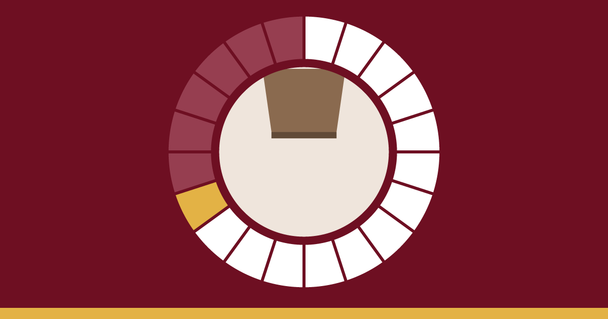

# The Wooden O

A twenty-day bootcamp from a strong C1 towards C2 Proficiency, staged around a passage of Shakespeare each day.

**Open it:** https://furkanork.github.io/cambridge/

## What's inside

- **Bootcamp:** 20 days in five acts. Each day has a passage, four expressions, three key word transformations in real exam format (two parts, 1 mark each), six words from the lists, and a writing and a speaking task.
- **80/20 word lists:** 205 items in 9 lists, ordered by usefulness, with the top fifth marked as core. Flashcards use spaced review (1, 3, 7 and 21 days), plus a gap quiz.
- **Phrasebook:** all 80 expressions, searchable, with the Shakespeare source where there is one.
- **Check-up:** Form A before day 1, Form B after day 20, to measure progress (22 marks, 20 minutes).
- **C2 exam map** and **How to study**, including a skill-score diagnostic that marks which days to do first.

## Put it on your phone

It installs like an app and works offline.

- **Android (Chrome):** open the link, tap the ⋮ menu, then **Install app** (or **Add to Home screen**).
- **iPhone (Safari):** open the link, tap **Share**, then **Add to Home Screen**.

## Your data

Progress, known words, drafts and test scores are saved on the device you use. The installed app and the claude.ai version keep separate copies. To move your work between them, use **How to study → Your data → Copy backup**, then **Restore from backup** on the other one.

Feedback from Claude, Listen and voice dictation only work in the claude.ai version. The phone app hides those buttons, and everything else works offline.

## Files

| File | What it is |
| --- | --- |
| `index.html` | The whole app: content, styles and script |
| `manifest.webmanifest` | App name, colours and icons for installing |
| `sw.js` | Service worker for offline use |
| `icons/` | App icons, favicon and the link-preview image |
| `tools/make-icons.js` | Draws the icons; run `node tools/make-icons.js` to rebuild them |

After changing `index.html`, bump `CACHE` in `sw.js` (for example to `wooden-o-v2`) so installed copies pick up the new icons and shell.
